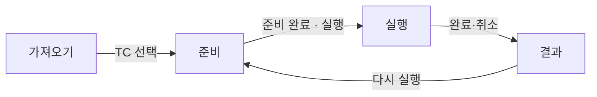

# 사용자 흐름·상태 전이

## 실행 상태

| 상태 | 화면 | 다음 |
| --- | --- | --- |
| running | RUNNING, 현재 기대 결과 강조, 대상 하이라이트 | waiting · error · done · cancelled |
| waiting | 하단 배너(로그인·도메인 이탈·새 탭·다운로드·인계) | 재개 → running, Blocked로 기록 → 해당 TC Blocked 후 다음 TC, 취소 |
| error | 원인 표시, 테스트 Fail로 바꾸지 않음 | 다시 시도(모델 오류만) → running, 여기서 종료 → done |
| done / cancelled | 결과 보기 | 결과 |

- 로그인 대기 중에는 캡처·AI 전송을 멈추고("CAPTURE PAUSED") 사용자는 앱에 표시된 실행 페이지에서 직접 로그인합니다. 이 화면은 로컬에만 표시하며 인계 대기 중에는 AI 전송을 중지합니다. 재개하면 현재 페이지를 다시 관찰합니다. 일반 인계에서는 선택적으로 확인 결과를 입력해 AI에 전달할 수 있습니다.
- 사용자 대기 중 AI는 동작하지 않습니다.
- 취소는 언제든 가능하고 중복 호출해도 안전합니다. 진행 중 모델 호출을 끊고 브라우저를 닫으며, 완료된 판정은 보존하고 나머지는 `미실행`("취소로 미실행")입니다. 실행 ID가 다르거나 취소된 뒤 도착한 응답은 버립니다.
- 다른 화면으로 가도 실행은 계속되고, 헤더 `실행` 탭에 진행률이 보입니다.
